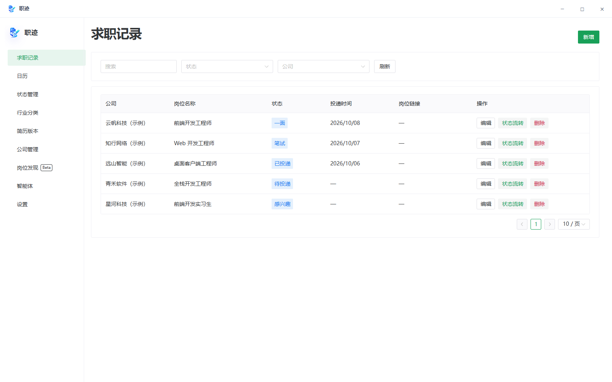
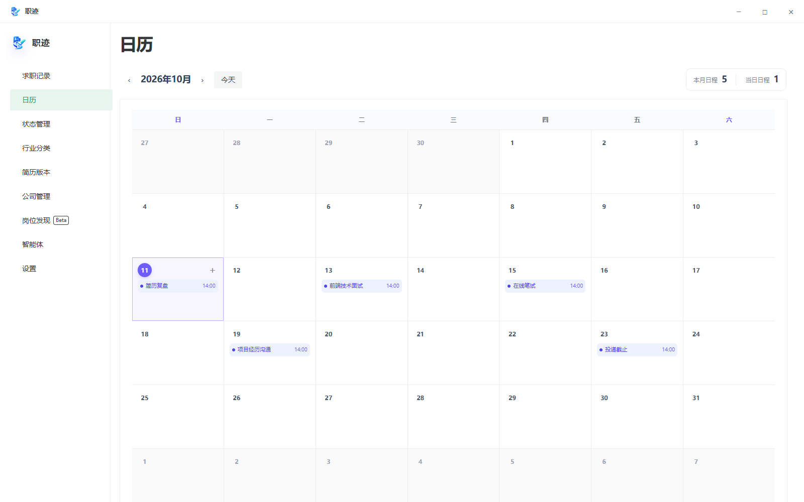
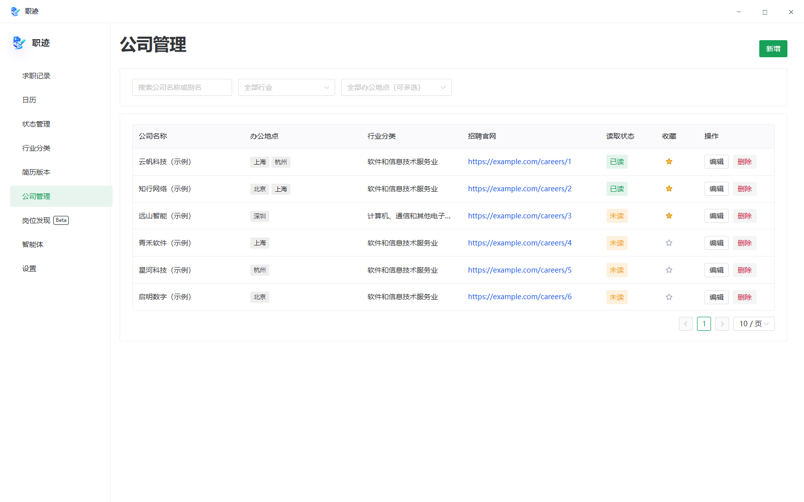
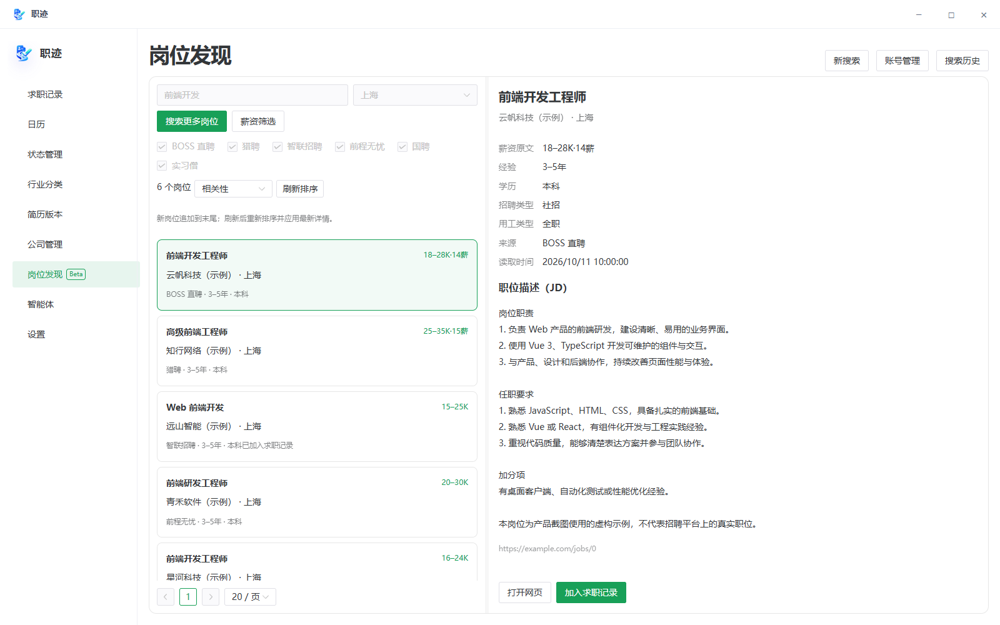
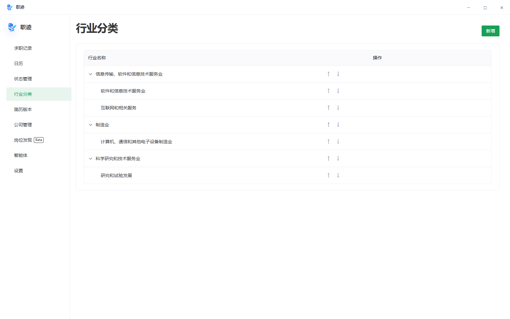
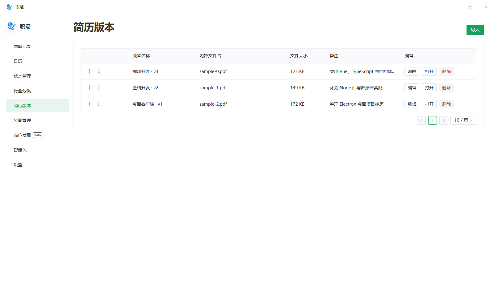
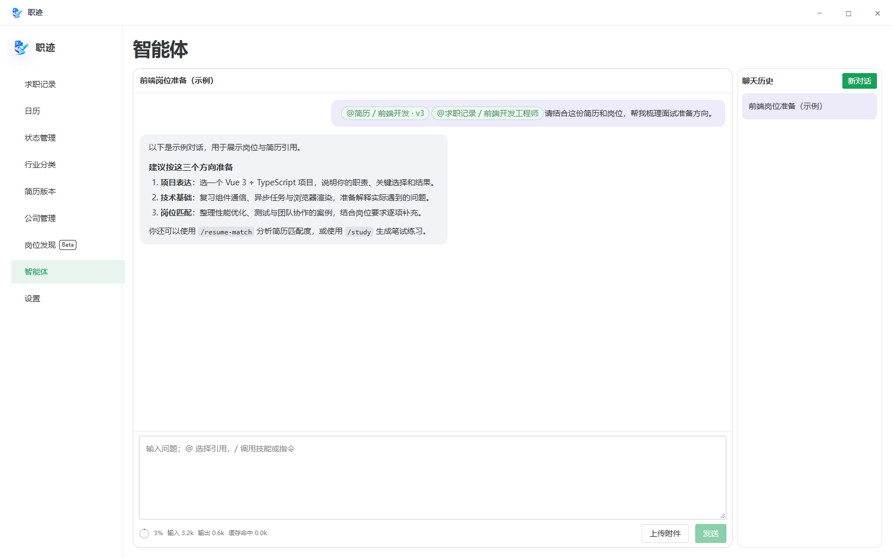

# 职迹 JobTrail

**简体中文** | [English](README.en.md)

职迹是一款面向 Windows 的本地求职管理桌面应用，将公司、岗位、简历、求职进度和面试日程集中在一起，帮助你有条理地推进每一次求职。

## 主要功能

- **求职记录**：管理岗位信息、投递状态和进度，关联简历与日程。
- **公司管理**：查找公司、浏览招聘官网，管理多个办公地点，按行业与办公地点组合筛选并收藏感兴趣的公司。
- **岗位发现（Beta）**：统一搜索 BOSS 直聘、猎聘、智联招聘、前程无忧、国聘、实习僧、鱼泡直聘、牛客和国家大学生就业服务平台，支持扫码登录、薪资筛选、相关性排序、详情浏览、搜索历史和加入求职记录。
- **简历管理**：保存多份简历，记录每次投递使用的版本。
- **日历提醒**：安排面试、笔试和截止日期，接收本地提醒。
- **智能体助手**：连接自选模型，引用简历与岗位、分析匹配度、生成笔试练习；支持上下文用量显示、对话压缩，以及通过 MCP 连接外部 AI 工具。
- **数据备份**：在设置中导出、导入完整备份，保存记录、配置、简历与聊天附件。

支持简体中文与 English、浅色与深色主题、系统托盘、开机启动和应用内更新。

## 技术栈

| 领域         | 技术                                                  | 用途                                  |
| ------------ | ----------------------------------------------------- | ------------------------------------- |
| 桌面应用     | Electron、TypeScript                                  | 主进程、预加载脚本及 Windows 桌面集成 |
| 用户界面     | Vue 3、Naive UI、Pinia、Vue I18n                      | 页面、组件、状态管理与多语言          |
| 本地数据     | SQLite、better-sqlite3                                | 在本机保存求职记录和应用数据          |
| 智能体与工具 | LangChain、LangGraph、MCP SDK                         | 智能体流程及外部工具连接              |
| 网页读取     | Playwright                                            | 按需读取动态网页内容                  |
| 构建与发布   | electron-vite、Vite、electron-builder、Velopack、Rust | 应用构建、Windows 安装、启动与更新    |
| 测试         | Vitest、Node.js 测试运行器、Playwright                | 单元测试及打包后的桌面应用测试        |

## 界面预览

以下为当前客户端中文界面，使用示例数据。点击图片可查看大图。

| 求职记录                                                                            | 日历日程                                                                              |
| ----------------------------------------------------------------------------------- | ------------------------------------------------------------------------------------- |
| [](docs/screenshots/applications.png) | [](docs/screenshots/calendar.png)           |
| 公司管理                                                                            | 岗位发现（Beta）                                                                      |
| [](docs/screenshots/companies.png)       | [](docs/screenshots/discovery.png) |
| 行业分类                                                                            | 简历版本                                                                              |
| [](docs/screenshots/industries.png)     | [](docs/screenshots/resumes.png)             |

**智能体助手**

[](docs/screenshots/assistant.png)

## 下载与使用

前往 [GitHub Releases](https://github.com/baozha2023/JobTrail/releases) 下载 **Windows x64** 安装包，按提示选择空目录安装。

安装器、卸载器及客户端首次启动根据系统显示语言使用中文或英文，其他语言默认使用中文。客户端语言可在设置中修改，后续启动保留选择。

安装后即可管理求职记录。首次使用会提供基础导航与岗位发现引导，也可在设置中重新开始。

- **搜索岗位**：先在账号管理中完成招聘平台的官方扫码登录，再输入关键词、选择地点进行搜索。遇到登录或网站验证提示时，按界面指引完成后继续。部分平台重启后需要重新扫码，搜索历史和已保存记录会保留。
- **使用智能体**：在设置中填写模型服务地址、模型名称和 API Key，即可在聊天中引用岗位、简历等内容。
- **连接外部 AI 工具**：在设置的 MCP 页面复制连接配置。MCP 默认开启，可随时关闭；实时岗位发现会按需在托盘启动职迹。

动态网页读取需要本机安装并更新 **Microsoft Edge Stable**。本地提醒需要应用保持运行，可以将窗口隐藏到托盘。

## 数据与隐私

职迹无需注册应用账号，不提供云同步，求职记录、简历和聊天历史保存在本机。使用智能体时，相关对话和选定内容会发送到你配置的模型服务。

招聘平台登录会话由本机浏览器管理，不包含在可移植备份中。

可在设置中导出完整备份，并保存到安装目录之外。**导入会替换当前数据，卸载会清空安装目录，请提前备份。**

## 本地开发

准备 Windows、Node.js、pnpm 和 Microsoft Edge Stable，并按[配置说明](AGENTS.md)创建本地私有构建配置 `private-build.config.json`。该文件不应提交到 Git，使用已有数据时请保留原构建密钥。

```powershell
pnpm install --frozen-lockfile
pnpm dev
```

常用命令：

| 命令                | 用途                |
| ------------------- | ------------------- |
| `pnpm typecheck`    | 类型检查            |
| `pnpm test`         | 运行测试            |
| `pnpm format:check` | 格式检查            |
| `pnpm build`        | 构建应用            |
| `pnpm release:win`  | 构建 Windows 安装包 |

安装包构建还需要 Rust MSVC、Visual Studio C++ Build Tools、.NET SDK 和 Velopack
CLI。开发与发布约定见[项目开发规范](AGENTS.md)。

## 项目文档

- [项目开发规范](AGENTS.md)
- [岗位发现](docs/job-discovery.md)
- [数据库结构](docs/database.md)
- [持久化升级规则](docs/persistence-upgrade-guide.md)
- [日志系统](docs/logging.md)
- [脚本与验收入口](scripts/README.md)

## 许可证

[MIT License](LICENSE)
