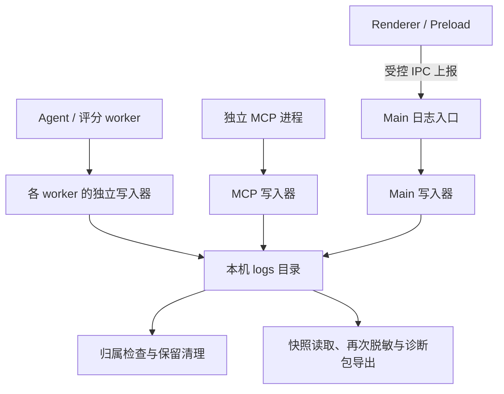

# 日志系统

本文介绍职迹应用日志的整体架构、事件契约、跨进程关联、文件维护、故障处理、诊断包导出和开发接入规则。代码中的 `diagnostics` 表示这套日志与诊断能力，统一入口为 `src/main/diagnostics.ts`。

## 范围与设计原则

日志用于解释操作过程和故障原因，保存在本机数据根目录的 `logs/` 中。开发环境对应项目根目录，安装环境对应用户选择的安装根目录；路径通过统一的数据目录解析规则获取。

- Main、Agent worker、简答题评分 worker 和独立 MCP 进程使用统一事件契约，各进程独立写文件。
- Renderer 与 Preload 通过受控 IPC 将事件交给 Main，使用同一套校验、脱敏和写入机制。
- 业务失败在负责处理的边界记录，保留原始异常原因；日志自身的失败通过备用输出和内部健康计数反映。
- 日志不采集业务正文或认证材料，不自动上传，不进入完整数据备份，也不作为业务数据、配置或升级恢复记录的替代品。
- Velopack、Rust 启动器、安装器和卸载器的原生输出属于各自运行时，不通过应用日志事件转换，也不包含在本诊断包的采集范围内。

日志结构版本为 `DIAGNOSTIC_VERSION = 1`，独立于客户端版本、数据库 `user_version`、配置 `configVersion` 和备份封装版本。新增业务操作、已登记错误码或可选属性通常无需升版；核心字段发生不兼容变化时才提高日志结构版本。

读取和导出只接受当前事件结构。旧格式仅用于识别安全清理对象，不转换成当前事件。业务数据库与配置继续使用各自正式迁移链，不能套用日志清理规则。

## 架构与模块职责



| 模块                               | 职责                                                                             |
| ---------------------------------- | -------------------------------------------------------------------------------- |
| `src/shared/error-codes.ts`        | 唯一错误码登记：默认级别、分类和国际化文案键                                     |
| `src/shared/diagnostics.ts`        | 事件类型、严格校验、异常标准化、脱敏和容量限制，无 Electron、文件系统或 Vue 依赖 |
| `src/main/diagnostics.ts`          | 公共入口、异步上下文、请求内异常去重、初始化缓冲和子进程备用输出接收             |
| `src/main/diagnostics/writer.ts`   | 独立进程写入、缓冲、分片、风暴聚合、备用输出和健康计数                           |
| `src/main/diagnostics/storage.ts`  | 日志目录安全、文件归属识别、维护锁、保留期限和空间预算                           |
| `src/main/diagnostics/export.ts`   | 文件快照、事件复核、再次脱敏、ZIP 生成、哈希验证和目标替换                       |
| `src/main/ipc/register-channel.ts` | 可信调用方校验、业务 IPC 上下文、失败引用和前端日志接收                          |
| `src/main/ipc/diagnostics.ts`      | 打开日志目录、选择诊断包目标和导出互斥                                           |
| `src/preload/index.ts`             | 请求上下文、前端日志确认与有界重试、IPC 传输失败记录                             |
| `src/renderer/diagnostics.ts`      | 前端故障上报和已有诊断引用复用                                                   |
| `src/renderer/utils/errors.ts`     | 通过错误码生成固定文案和诊断编号                                                 |

业务 Service 使用公共入口，不创建日志文件，不自行序列化异常或维护另一套错误过滤名单。Repository 和纯函数通常向上传播异常，由拥有业务上下文的边界记录。

## 初始化与进程生命周期

Main 在初始化业务服务前建立日志入口；MCP 和 Agent 各有 bootstrap，在加载主要业务模块前初始化日志。进程初始化参数明确来源类型、客户端版本、安装模式和数据根目录。

初始化之前的事件最多缓冲 256 条，并尝试输出脱敏 stderr；超出容量或备用输出失败计入早期丢弃数量。初始化后重放缓冲，并记录 `diagnostics.initialize` 及维护统计。

全局监听覆盖未捕获异常、未处理 Promise 拒绝、Vue 组件错误、Renderer 加载和进程异常退出。Preload 的全局监听仅报告堆栈能确认来自自身模块的故障，避免重复接收页面错误。全局监听承担最后兜底，业务边界仍须主动接入。

正常关闭时刷写缓冲并关闭当前分片。Main 在应用退出前刷写，写入器注册进程退出清理；更新和导出等流程通过 `flushDiagnostics()` 刷写当前进程日志。强杀、断电或所有输出设备失效时可能丢失记录，不承诺完整落盘。

## 事件契约

日志采用 UTF-8 JSONL：首行为文件头，之后每行一个事件。文件头包含 `format: 'jobtrail-diagnostics'`、`schemaVersion`、写入进程、PID、实例 UUID 和创建时间。

| 字段                     | 含义与规则                                             |
| ------------------------ | ------------------------------------------------------ |
| `schemaVersion`          | 当前日志结构版本                                       |
| `timestamp`              | UTC ISO 时间，使用毫秒精度                             |
| `eventId`                | 单次事件 UUID；传输重试保持不变                        |
| `traceId`                | 一次请求或任务链的 UUID                                |
| `spanId`、`parentSpanId` | 当前操作及可选父操作 UUID                              |
| `process`、`pid`         | 事件来源及对应进程 ID                                  |
| `instanceId`、`sequence` | 写入实例和有序写入编号，区分进程重启及 PID 重用        |
| `appVersion`             | 客户端版本；启动参数尚不可用时允许 `unknown`           |
| `kind`                   | `error`、`operation` 或 `maintenance`                  |
| `level`                  | `info`、`warn`、`error` 或 `fatal`                     |
| `operation`              | 稳定操作名，符合 `^[a-z][a-z0-9.-]{0,95}$`             |
| `code`                   | 可选的已登记错误码                                     |
| `outcome`                | 可选的 `started`、`succeeded`、`failed` 或 `cancelled` |
| `error`                  | 标准化异常树，不保存原始异常对象                       |
| `attributes`             | 受限的计数、耗时、版本和关联事件属性                   |

前端事件由 Main 重新校验，PID 来自可信 WebContents，写入实例和序号由接收端建立。Agent 和 MCP 使用自己的写入实例。文件头标识实际写文件的进程，文件中的事件可以来自该进程接收的其他来源。

`attributes` 仅允许以下字段，不接受任意业务对象或自由文本：

- 耗时和统计：`durationMs`、`count`、`failedCount`、`skippedCount`、`attempt`、`exitCode`。
- 结构版本：`databaseVersion`、`configVersion`。
- 聚合及关联：`firstSeenAt`、`lastSeenAt`、`relatedEventId`。

新增属性必须同步修改类型、接收校验和契约测试。事件、异常及属性对象拒绝未知字段；单事件最大 32 KiB，不将接口放宽为 `Record<string, unknown>`。

## 记录入口与责任

| 入口                                       | 用途                                               |
| ------------------------------------------ | -------------------------------------------------- |
| `captureError(error, options)`             | 记录异常并返回包含 eventId、trace/span 的诊断引用  |
| `recordEvent(event)`                       | 记录固定操作、结果或维护事件及受限属性             |
| `runOperation(options, callback)`          | 建立子操作，记录开始、结果、耗时，并记录抛出的异常 |
| `withDiagnosticContext(context, callback)` | 在已有请求或任务上下文中执行                       |
| `currentDiagnosticContext()`               | 取得当前异步上下文，供受控跨进程传播               |
| `flushDiagnostics()`                       | 刷写当前进程缓冲                                   |

```ts
const result = await runOperation({ operation: 'catalog.refresh' }, async () => {
  return await refreshCatalog()
})

try {
  await cleanup()
} catch (error) {
  captureError(error, { operation: 'catalog.cleanup' })
}
```

记录责任遵循异常的处理边界：

- 当前层完成恢复、重试、降级、清理或吞掉异常时，在当前层记录。
- 原样向上传播的异常交由 IPC、MCP 或任务执行边界记录，避免每层重复。
- 业务包装使用 `AppServiceError(code, message, details?, { cause })` 保留原始原因；主操作和回滚同时失败时使用 `AggregateError`。
- 校验拒绝、不存在和冲突同样需要记录，不以“预期业务错误”为由过滤。
- 正常取消使用 `cancelled` 结果；日志失败不能改变已经成功的业务结果，也不能吞掉原业务异常。

`runOperation` 对正常返回记录成功，对返回的 `'cancelled'` 记录取消，对 `isError: true` 结果记录失败；抛出的取消异常也记录取消结果并继续向上抛出。需要异常原因时仍须由对应错误边界调用 `captureError`。

操作名描述固定的技术边界，例如 `ipc.company.create`、`mcp.tool.list-companies`、`agent.run`。操作名中不能拼接用户输入、查询条件、URL、文件路径或业务正文。不采用业务操作白名单；命名格式、字段校验和数据边界共同约束日志输入。

## 错误码、级别与用户提示

错误码和默认策略集中在 `src/shared/error-codes.ts`，业务逻辑按稳定错误码判断，不能依赖本地化消息。

| 情况                                   | 默认处理                      |
| -------------------------------------- | ----------------------------- |
| 校验失败、不存在、冲突等已登记业务拒绝 | 通常为 `warn`，以登记策略为准 |
| 密钥缺失、网络、文件、数据库及内部故障 | 通常为 `error`，保留脱敏原因  |
| 进程无法继续、致命启动故障             | 对应边界使用 `fatal`          |
| 已识别取消                             | `info`，记录 `cancelled`      |

已登记错误直接使用对应策略；数据库版本异常映射为 `DATABASE_VERSION_UNSUPPORTED`，SQLite 外部错误映射为 `DATABASE_ERROR`，系统错误映射为 `SYSTEM_ERROR`，其余未识别异常使用 `INTERNAL_ERROR`。原始外部 code 保留在标准化异常的 `originalCode` 中。

UI 根据登记的国际化文案键显示固定提示，并追加 `[错误码 · 完整 eventId]`，不直接展示异常正文、堆栈或认证地址。Main 已处理的失败通过可序列化诊断引用跨进程返回；Renderer 复用该引用，不重复上报。

## 上下文、跨进程传输与去重

Node 内使用 `AsyncLocalStorage` 关联异步执行。`runOperation` 创建子 span，保留父 trace；跨进程边界显式传递上下文，不能假设异步上下文会自动穿过 IPC 或进程。

| 链路                            | 传播与校验规则                                                                             |
| ------------------------------- | ------------------------------------------------------------------------------------------ |
| Renderer → Preload → Main       | 每次业务请求生成上下文，以 `{ context, args }` 信封发送；Main 校验可信主窗口、主框架及信封 |
| Renderer / Preload → 日志接收器 | `diagnostics:report` 只接受可信主框架和这两类来源，再做严格事件校验                        |
| Main → Agent / 评分 worker      | 任务携带上下文，worker 在该上下文中执行，结果携带安全诊断引用                              |
| 内置 Agent → MCP                | 通过请求 `_meta['jobtrail/diagnostics']` 传播上下文                                        |
| 外部 MCP → 工具执行             | 没有合法上下文时创建新 trace；SDK 参数校验失败独立记录                                     |
| 子进程 stderr → 父进程          | UTF-8 流解码，按完整行限额和当前事件契约接收，不转存原始非结构化输出                       |

所有诊断 ID 只用于关联，不授予业务权限。MCP 的 stdout 专用于协议输出，日志不写入其中。

同一 trace 中重复处理同一个异常对象时复用已有引用；同一个 Error 被不同请求复用时分别记录。已携带合法诊断引用的跨进程错误直接复用该引用。写入器另按 eventId 去重传输重试，缓存上限为 10,000 条；异常对象最多保留 8 个 trace 引用。

Preload 上报等待确认，每次最多 2 秒，最多重试一次，重试沿用 eventId。回执含义如下：

| 状态          | 含义                                       |
| ------------- | ------------------------------------------ |
| `written`     | 已完成当前文件写入                         |
| `buffered`    | 已接收，等待缓冲刷写或聚合，不表示已经落盘 |
| `fallback`    | 已转向脱敏备用输出                         |
| `unavailable` | 接收、校验或输出不可用                     |
| `duplicate`   | 已接收过同 eventId，不重复写入             |

重试仍失败时，前端输出带 `transportDegraded` 标记的脱敏 console 记录。该输出不能视为已进入文件日志。安装模式下，父进程接收到子进程合法的备用事件时保留原 eventId 和 trace，将其写入自身文件，并累计传输降级；非结构化或超限输出只形成固定传输错误，不携带原文。

## 异常标准化与隐私边界

异常先标准化和脱敏，再按容量限制裁剪。仅保留异常名称、消息、原始 code、可识别的 HTTP 状态、堆栈、cause、聚合异常及截断/不可读/已脱敏标记。

| 项目     | 限制                                                  |
| -------- | ----------------------------------------------------- |
| 消息     | 最多约 4 KiB，按 UTF-8 字节计算                       |
| 堆栈     | 最多 20 帧，每帧约 512 字节                           |
| cause    | 最多 5 层，循环引用标记截断                           |
| 聚合异常 | 每组最多 10 项，整棵异常树有 64 节点预算              |
| 单事件   | 最大 32 KiB；超限时压缩异常详情，接收端仍执行限额校验 |

读取异常时只检查数据描述符及运行时原生 stack accessor，不执行任意 getter、`toJSON` 或自定义字符串转换。JSON 解析和 Zod 错误可能夹带输入，保留错误类别并替换消息正文，不复制完整输入或校验对象。

自动脱敏覆盖：

- 当前进程登记的模型密钥，以及可识别的 API Key、password、secret、访问令牌等值。
- Bearer / Basic 认证内容，Authorization、代理认证及 Cookie / Set-Cookie 头。
- URL 内嵌凭据、查询参数值和片段；可保留 origin/path 供定位。
- 机器绝对路径和控制字符；堆栈保留应用或依赖相对路径。

接收跨进程事件及导出时重新校验并再次脱敏，不信任生产者的“已脱敏”标记。配置加载和评分 worker 在使用模型密钥前调用 `registerDiagnosticSecrets`，密钥登记仅留在进程内存中。

调用方禁止记录请求或响应正文、完整 SDK 异常对象、配置对象、环境变量、简历、聊天、题目作答、岗位正文、搜索条件、二维码、Cookie、临时扫码标识或验证地址参数。诊断属性仅保存受限统计。自由文本脱敏无法识别任意隐私，不能代替调用方的数据边界约束。

## 文件写入、轮转与聚合

```text
<数据根目录>/logs/
  main-<pid>-<instance>-<segment>.active.jsonl
  agent-<pid>-<instance>-<segment>.closed.jsonl
  mcp-<pid>-<instance>-<segment>.closed.jsonl
  .maintenance.lock
```

进程类别、PID、随机实例 UUID 和分片序号共同标识文件，避免并发进程及 PID 重用相互覆盖。当前分片使用 `.active.jsonl`，正常关闭或轮转后改为 `.closed.jsonl`。每片上限 5 MiB，达到容量时关闭旧片并创建新片，不清空旧内容。

普通 `info` 事件最多缓冲 1 MiB，首次入队后约 100 毫秒刷写；容量不足时先刷写已有队列。`warn/error/fatal` 先刷写队列，再立即尝试写入当前事件。开发环境同时输出脱敏 stderr；安装环境正常情况下写文件，文件写入失败时才启用备用 stderr。

同类事件按来源、类型、结果、操作名、错误码、异常名称和消息分组：10 秒窗口内保留前 100 条，后续记录聚合次数并输出 `diagnostics.aggregate`。汇总包含代表事件 ID、首末时间与额外次数；聚合组缓存最多 256 项。聚合可能覆盖不同 trace，排查时应同时查看汇总和内部 aggregated 计数，不能将逐行数量当作实际发生次数。

## 文件维护与保留清理

维护在写入器初始化、每 60 秒以及导出前执行。默认保留 14 天，空间目标为 50 MiB；清理按文件修改时间从旧到新进行，不按事件时间逐行修改文件。

维护使用日志目录内的独占锁，并记录持有 PID。其他存活进程持锁时跳过本轮；确认锁持有者已退出后才移除旧锁。路径、锁文件或维护操作异常累计 maintenanceFailures。

清理规则：

- 只管理目录内符合应用命名规则的候选文件，并复核文件头、来源、PID 和实例身份。
- 日志目录必须为真实目录；清理目标必须为目录内普通文件，拒绝链接和目录外路径。
- 已确认的旧结构文件在进程不再使用后删除，不执行事件迁移。
- 当前结构仅关闭的分片或所属进程已退出的分片可以清理；超过期限或空间目标时删除。
- 未来版本、身份不符及未知/损坏的候选文件跳过，反映到 skippedFiles；命名不匹配的文件不纳入管理。
- 存活进程的活跃分片保留。无法清到空间目标时设置 overBudget，不为达到预算而强删。

50 MiB 是受上述安全条件约束的空间目标，活跃、未来或损坏文件可能使目录继续超额。

## 故障降级与内部健康状态

文件写入失败时，写入器累计 writeFailures、设置 degraded，并尝试输出原事件及关联的 `DIAGNOSTICS_WRITE_FAILED` 记录到脱敏 stderr。部分写入可能留下不完整末行，该分片停止追加；后续写入重新建片，恢复成功时记录 `diagnostics.recovered`。

备用输出失败或重入时累计 dropped。日志系统内部失败不递归调用自身错误入口，避免无限重入；接收失败、维护失败和输出失败通过固定错误或计数表达。

| 健康字段              | 含义                           |
| --------------------- | ------------------------------ |
| `degraded`            | 当前写入器处于降级状态         |
| `writeFailures`       | 文件写入失败累计数             |
| `transportFailures`   | 备用输出或子进程传输降级累计数 |
| `dropped`             | 无法接收或输出的事件累计数     |
| `aggregated`          | 超过风暴阈值而聚合的事件累计数 |
| `deletedFiles`        | 维护删除文件累计数             |
| `maintenanceFailures` | 维护操作失败累计数             |
| `skippedFiles`        | 最近维护跳过的候选文件数       |
| `overBudget`          | 最近维护后是否仍超空间目标     |

健康状态属于各自写入器，诊断包附带当前导出进程的健康快照，不代表所有进程计数之和。设置页不显示或查询健康状态；排查通过诊断包清单读取。没有用户提示或日志行不能单独证明没有故障。

## 设置页与诊断包导出

设置页的“日志与诊断”提供两项操作：

| 接口                                                         | 行为                                                                 |
| ------------------------------------------------------------ | -------------------------------------------------------------------- |
| `diagnostics.openDirectory()` / `diagnostics:open-directory` | 打开受控日志目录，无任意路径参数                                     |
| `diagnostics.exportBundle()` / `diagnostics:export`          | Main 原生对话框选择 ZIP 目标，无任意路径参数，同一时刻只执行一次导出 |

用户取消返回 `cancelled`，不作为失败提示。导出完成返回 `exported`，底层失败转换为登记错误并保留 cause。

导出范围为最近 24 小时、时间不晚于导出时刻的当前结构事件，包括各进程符合条件的日志。先刷写当前进程缓冲并执行维护，再按已观察到的文件长度读取快照；其他进程以已经写入文件的内容为准。导出不冻结业务数据库，允许文件继续追加或轮转。

ZIP 包含：

- `logs/` 下经校验并再次脱敏的事件文件及原文件头。
- `manifest.json`：导出时间与时间范围，应用、Electron、Node、系统及架构信息，数据库/配置目标结构版本。
- 当前进程健康快照、本次维护统计、跳过文件数、无效记录数和末尾半行数。
- 每个导出日志文件的路径、大小与 SHA-256。

读取时重新检查普通文件、链接、文件身份和文件头；损坏行、超限行、文件消失及末尾半行通过清单统计反映，不把未读取内容报告为完整成功。没有符合时间范围的事件时可以只有清单。

目标必须位于日志目录外。先在目标目录创建随机临时 ZIP，完成后重新读取 ZIP 并验证全部条目哈希，再替换目标文件；失败保留已有目标并清理临时文件，文件句柄关闭后才清理。

诊断包是普通 ZIP，脱敏不等于加密。它不包含 SQLite、配置、附件或环境变量，不自动发送到外部；由用户决定是否提供给维护者。完整数据备份与诊断包用途、范围和封装各自独立。

## 业务接入与扩展规则

新增错误码时，在共享注册表定义级别、分类和文案键；用户可见码同步中英文文案及映射测试。组件和日志引擎不另加业务错误名单。

新增业务操作时，在实际负责的边界使用公共入口，选择固定点分操作名，复用已有上下文，只传递已登记统计属性。新增事件属性、来源或结构必须同步类型、严格校验、生产者、接收器、导出和契约测试。

各业务链路遵守相同原则：

- IPC 为失败附加安全诊断引用；备份、更新、诊断包导出等关键操作另记录开始、结果及耗时。
- Agent、文档解析及评分记录执行边界和已处理的降级，不记录提示词、模型响应、附件内容或作答。
- 试卷 PDF 导出成功使用 `exam.export-pdf`，仅记录题数与耗时；失败由业务 IPC 边界记录并返回诊断引用。隔离打印页只通过专用最小 Preload 上报携带诊断信封的任务 ID 与阶段，Main 校验任务、窗口及主框架；题目、默认答案、作答与保存路径不得作为日志属性。
- MCP 记录工具执行、输入/输出校验、协议及连接错误，不能输出原始参数或污染 stdout。
- 岗位发现记录采集结果和受限计数，在账号检查、扫码、验证窗口、网络预检、页面加载、详情及受控管道的处理边界保留异常原因。
- 岗位发现的登录、验证、范围未核实、解析失败等业务状态按现有 DTO 返回；真实空批次、用户取消和正常预算停止保持各自语义。单条解析失败仅记录条目数和失败数，不能携带岗位或响应原文。
- 动态拼接固定状态时，将不符合操作名格式的下划线转换为连字符；业务状态、数据库字段和 IPC/MCP 返回值仍按原契约保存。

岗位发现的共性行为见 [岗位发现](job-discovery.md)，数据库和配置迁移见 [持久化升级指南](persistence-upgrade-guide.md)。本文件只定义统一日志机制和接入规则。

## 排查流程与验证

收到用户的诊断编号后：

1. 先读取诊断包清单，确认时间范围、版本、维护统计、降级、聚合、无效行及跳过文件情况。
2. 在 JSONL 中定位 eventId，再按 traceId、spanId、parentSpanId 和 relatedEventId 关联 Main、worker 与 MCP 过程。
3. 结合操作结果、错误码、脱敏 cause 和统计判断故障。跨进程文件独立，编号和时间只能在各自语境中解释。
4. 区分业务拒绝、取消、网络故障和日志输出故障；记录缺失时说明证据范围，不用“没有日志”推断操作未发生。

不通过索取完整数据目录来替代诊断包，不要求用户提供密钥、Cookie 或未脱敏业务材料。

| 验证入口                             | 覆盖范围                                                                                |
| ------------------------------------ | --------------------------------------------------------------------------------------- |
| `tests/diagnostics.test.ts`          | 协议、异常树、危险 getter、脱敏、级别、上下文隔离、去重、轮转、聚合、故障恢复和安全清理 |
| `tests/diagnostics-ipc.test.ts`      | 可信来源、上下文和安全错误引用、上报确认及重试去重                                      |
| `tests/preload-diagnostics.test.ts`  | IPC 传输故障、既有引用复用、Preload 来源判定                                            |
| `tests/renderer-diagnostics.test.ts` | 前端脱敏上报和 Main 已处理错误复用                                                      |
| `tests/diagnostics-export.test.ts`   | 24 小时时间范围、再次脱敏、损坏/半行统计、哈希与已有目标保护                            |
| `pnpm test:diagnostics:package`      | 隔离安装包中的 MCP / Agent 文件日志、客户端版本与 stdout/stderr 输出边界                |

单元与契约测试随 `pnpm test` 执行；安装包验收需先运行 `pnpm package:win`。这些检查证明对应机制和故障边界，不能将合成测试结果替代真实业务链路验收。
